<!-- ========================================== -->
<!-- 00. MASTER TERMINAL HEADER BANNER         -->
<!-- ========================================== -->

  

<!-- ========================================== -->
<!-- 01. PROFILE HERO SECTION                  -->
<!-- ========================================== -->
<table width="100%" border="0" cellpadding="0" cellspacing="0">
  <tr>
    <!-- LEFT COLUMN: ABOUT TERMINAL & BIO -->
    <td width="72%" valign="top" align="left">
       ABOUT" />
        
      <h1 align="left" style="margin: 0; color: #F0F6FC; font-family: 'Courier New', monospace;">
        Divya Sharma
      </h1>
      <!-- ANIMATED TYPING TAGLINE -->
      
       
      

        Computer Engineering undergraduate at <b>Shree L. R. Tiwari College of Engineering (SLRTCE)</b> passionate about Artificial Intelligence, Machine Learning, DSA, and scalable software systems. 
        Combining entrepreneurial thinking, competitive hackathon innovation, and edge technology to build high-impact real-world solutions. Currently preparing for <b>GATE 2027 (Computer Science)</b> with the ambition of pursuing M.Tech at an IIT.
      

      

        
        
        
        
        
        
      

    </td>

    <!-- RIGHT COLUMN: AVATAR & VERIFIED STATUS -->
    <td width="28%" align="center" valign="middle">
       
      
        
      
       
      <small style="color: #8B949E; font-family: monospace;">@divyaa404</small>
    </td>
  </tr>
</table>

 

<!-- ========================================== -->
<!-- 02. ANIMATED GITHUB STATISTICS (TELEMETRY) -->
<!-- ========================================== -->
 TELEMETRY // STATS" />

  

<!-- 4-COLUMN HORIZONTAL PIXEL STATISTICS BAR (AUTO-UPDATED VIA GITHUB ACTIONS) -->

  

<!-- REAL-TIME DYNAMIC STATS & STREAK CARDS -->
<table width="100%" border="0" cellpadding="0" cellspacing="8">
  <tr>
    <td width="50%" align="center" valign="top">
      
    </td>
    <td width="50%" align="center" valign="top">
      
    </td>
  </tr>
</table>

 

<!-- TOP LANGUAGES CARDS -->

  

<!-- ========================================== -->
<!-- 03. FEATURED PROJECTS SECTION              -->
<!-- ========================================== -->
 PROJECTS" />

  

<!-- TWO-COLUMN PROJECT GRID -->
<table width="100%" border="0" cellpadding="8" cellspacing="0">
  <tr>
    <!-- PROJECT 1: AgriVyaan -->
    <td width="50%" valign="top">
      <table width="100%" border="0" cellpadding="6" cellspacing="0">
        <tr>
          <td width="72" valign="top" align="center">
            
          </td>
          <td valign="top" align="left">
            <a href="https://github.com/divyaa404/AgriVyaan">
              <strong style="color: #F0F6FC; font-size: 16px;">AgriVyaan</strong>
            </a>
            &nbsp;
            
            

              Edge-AI autonomous agricultural drone monitoring system. Real-time crop disease detection and offline-first telemetry for smart farming.
            

            

              
              
              
              
              
            

             
            <a href="https://github.com/divyaa404/AgriVyaan" style="color: #39D353; font-family: monospace; font-size: 12px; text-decoration: none;">
              <b>&gt; Launch Repository →</b>
            </a>
          </td>
        </tr>
      </table>
    </td>

    <!-- PROJECT 2: GullyGig -->
    <td width="50%" valign="top">
      <table width="100%" border="0" cellpadding="6" cellspacing="0">
        <tr>
          <td width="72" valign="top" align="center">
            
          </td>
          <td valign="top" align="left">
            <a href="https://github.com/divyaa404/GullyGig">
              <strong style="color: #F0F6FC; font-size: 16px;">GullyGig</strong>
            </a>
            &nbsp;
            
            

              Digital identity and opportunity platform for local skilled workers. Portfolio showcase and hyper-local talent discovery network.
            

            

              
              
              
              
            

             
            <a href="https://github.com/divyaa404/GullyGig" style="color: #39D353; font-family: monospace; font-size: 12px; text-decoration: none;">
              <b>&gt; Launch Repository →</b>
            </a>
          </td>
        </tr>
      </table>
    </td>
  </tr>

  <tr>
    <!-- PROJECT 3: Campus360 -->
    <td width="50%" valign="top">
      <table width="100%" border="0" cellpadding="6" cellspacing="0">
        <tr>
          <td width="72" valign="top" align="center">
            
          </td>
          <td valign="top" align="left">
            <a href="https://github.com/divyaa404/Campus360">
              <strong style="color: #F0F6FC; font-size: 16px;">Campus360</strong>
            </a>
            &nbsp;
            
            

              Comprehensive college management portal automating institutional operations, student workflows, academic analytics, and faculty scheduling.
            

            

              
              
              
              
            

             
            <a href="https://github.com/divyaa404/Campus360" style="color: #39D353; font-family: monospace; font-size: 12px; text-decoration: none;">
              <b>&gt; Launch Repository →</b>
            </a>
          </td>
        </tr>
      </table>
    </td>

    <!-- PROJECT 4: SYNDEO -->
    <td width="50%" valign="top">
      <table width="100%" border="0" cellpadding="6" cellspacing="0">
        <tr>
          <td width="72" valign="top" align="center">
            
          </td>
          <td valign="top" align="left">
            <a href="https://github.com/divyaa404/SYNDEO">
              <strong style="color: #F0F6FC; font-size: 16px;">SYNDEO</strong>
            </a>
            &nbsp;
            
            

              Decentralized personal identity and data graph system enabling privacy-preserving attribute attestations and unified developer footprints.
            

            

              
              
              
              
            

             
            <a href="https://github.com/divyaa404/SYNDEO" style="color: #39D353; font-family: monospace; font-size: 12px; text-decoration: none;">
              <b>&gt; Launch Repository →</b>
            </a>
          </td>
        </tr>
      </table>
    </td>
  </tr>

  <tr>
    <!-- PROJECT 5: BrandShield AI -->
    <td width="50%" valign="top">
      <table width="100%" border="0" cellpadding="6" cellspacing="0">
        <tr>
          <td width="72" valign="top" align="center">
            
          </td>
          <td valign="top" align="left">
            <a href="https://github.com/divyaa404/BrandShield">
              <strong style="color: #F0F6FC; font-size: 16px;">BrandShield AI</strong>
            </a>
            &nbsp;
            
            

              Multi-agent brand consistency and content governance platform featuring versioned memory models, compliance auditing, and approval pipelines.
            

            

              
              
              
              
            

             
            <a href="https://github.com/divyaa404/BrandShield" style="color: #39D353; font-family: monospace; font-size: 12px; text-decoration: none;">
              <b>&gt; Launch Repository →</b>
            </a>
          </td>
        </tr>
      </table>
    </td>

    <!-- PROJECT 6: Mochatrade -->
    <td width="50%" valign="top">
      <table width="100%" border="0" cellpadding="6" cellspacing="0">
        <tr>
          <td width="72" valign="top" align="center">
            
          </td>
          <td valign="top" align="left">
            <a href="https://github.com/divyaa404/Mochatrade">
              <strong style="color: #F0F6FC; font-size: 16px;">Mochatrade</strong>
            </a>
            &nbsp;
            
            

              High-throughput fintech and quantitative trading platform providing real-time market sentiment intelligence, technical indicators, and execution tools.
            

            

              
              
              
              
            

             
            <a href="https://github.com/divyaa404/Mochatrade" style="color: #39D353; font-family: monospace; font-size: 12px; text-decoration: none;">
              <b>&gt; Launch Repository →</b>
            </a>
          </td>
        </tr>
      </table>
    </td>
  </tr>
</table>

 

<!-- ========================================== -->
<!-- 04. TECH STACK SECTION                     -->
<!-- ========================================== -->
 TECH_STACK" />

  

<table width="100%" border="0" cellpadding="8" cellspacing="0">
  <tr>
    <td width="25%" valign="top" align="left">
      <small style="color: #39D353; font-family: monospace; font-weight: bold;">[LANGUAGES &amp; DSA]</small> 
       
       
       
       
      
    </td>
    <td width="25%" valign="top" align="left">
      <small style="color: #1F6FEB; font-family: monospace; font-weight: bold;">[AI / ML &amp; EDGE]</small> 
       
       
       
       
      
    </td>
    <td width="25%" valign="top" align="left">
      <small style="color: #E3B341; font-family: monospace; font-weight: bold;">[FRAMEWORKS &amp; WEB]</small> 
       
       
       
       
      
    </td>
    <td width="25%" valign="top" align="left">
      <small style="color: #39D353; font-family: monospace; font-weight: bold;">[DATA, CLOUD &amp; DEVOPS]</small> 
       
       
       
       
      
    </td>
  </tr>
</table>

 

<!-- ========================================== -->
<!-- 05. VERIFIED ACHIEVEMENTS SECTION          -->
<!-- ========================================== -->
 ACHIEVEMENTS" />

  

  

<!-- VERIFIED HACKATHON BADGES & HONORS SHOWCASE -->
<table width="100%" border="0" cellpadding="8" cellspacing="0">
  <tr>
    <td width="33.3%" align="center" valign="top">
       
      <strong style="color: #39D353; font-family: monospace; font-size: 12px;">GLOBAL WINNER - TOP 25</strong> 
      <small style="color: #9BA3AE;">HACKHAZARDS &apos;26 • Namespace</small>
    </td>
    <td width="33.3%" align="center" valign="top">
       
      <strong style="color: #39D353; font-family: monospace; font-size: 12px;">RANK 1 - RENDER TRACK</strong> 
      <small style="color: #9BA3AE;">HACKHAZARDS &apos;26 Innovation Track</small>
    </td>
    <td width="33.3%" align="center" valign="top">
       
      <strong style="color: #1F6FEB; font-family: monospace; font-size: 12px;">TOP 20 PROJECT KERNELS</strong> 
      <small style="color: #9BA3AE;">Nexus Spring of Code 2026</small>
    </td>
  </tr>
  <tr>
    <td width="33.3%" align="center" valign="top">
       
       
      <strong style="color: #E3B341; font-family: monospace; font-size: 12px;">HACKNEXT 1.0 2026</strong> 
      <small style="color: #9BA3AE;">CSI TCET &amp; Athera AI Club</small>
    </td>
    <td width="33.3%" align="center" valign="top">
       
       
      <strong style="color: #E3B341; font-family: monospace; font-size: 12px;">3RD PRIZE WINNER (₹7,000)</strong> 
      <small style="color: #9BA3AE;">MochaTrade Confederation</small>
    </td>
    <td width="33.3%" align="center" valign="top">
       
       
      <strong style="color: #39D353; font-family: monospace; font-size: 12px;">3RD RUNNERS UP</strong> 
      <small style="color: #9BA3AE;">Geeks2Code (GFG Campus)</small>
    </td>
  </tr>
</table>

 

<!-- ========================================== -->
<!-- 06. LIVE CONTRIBUTION HEATMAP / GRAPH      -->
<!-- ========================================== -->
 ACTIVITY_HEATMAP" />

  

<!-- DYNAMIC REAL-TIME CONTRIBUTION GRAPH -->

  

<!-- ========================================== -->
<!-- 07. TRANSMISSION // CONNECT                -->
<!-- ========================================== -->
 TRANSMISSION // CONNECT" />

  

  
  &nbsp;
  
  &nbsp;
  
  &nbsp;
  
  &nbsp;
  
  &nbsp;
  
  &nbsp;
  

 

<!-- TERMINAL FOOTER CMD LINE -->

