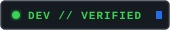
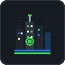

<!-- ========================================== -->
<!-- 00. MASTER TERMINAL HEADER BANNER         -->
<!-- ========================================== -->

  

<!-- ========================================== -->
<!-- 01. PROFILE HERO SECTION                  -->
<!-- ========================================== -->
<table width="100%" border="0" cellpadding="0" cellspacing="0">
  <tr>
    <!-- LEFT COLUMN: ABOUT TERMINAL & BIO -->
    <td width="72%" valign="top" align="left">
       ABOUT" />
        
      <h1 align="left" style="margin: 0; color: #F0F6FC; font-family: 'Courier New', monospace;">
        Indresh Suresh Pathinenchil
      </h1>
      <!-- ANIMATED TYPING TAGLINE -->
      
       
      

        Second-year Computer Engineering developer passionate about architecting scalable distributed systems, intelligent drone autonomy, and high-impact digital infrastructure. 
        Bridging edge artificial intelligence with physical telemetry and municipal-scale coordination platforms.
      

      

        
        
        
        
      

    </td>

    <!-- RIGHT COLUMN: AVATAR & VERIFIED STATUS -->
    <td width="28%" align="center" valign="middle">
       
      
        
      
       
      <small style="color: #8B949E; font-family: monospace;">@indresh404</small>
    </td>
  </tr>
</table>

 

<!-- ========================================== -->
<!-- 02. ANIMATED GITHUB STATISTICS (TELEMETRY) -->
<!-- ========================================== -->
 TELEMETRY // STATS" />

  

<!-- 4-COLUMN HORIZONTAL PIXEL STATISTICS BAR (AUTO-UPDATED VIA GITHUB ACTIONS) -->

  

<!-- REAL-TIME DYNAMIC STATS & STREAK CARDS -->
<table width="100%" border="0" cellpadding="0" cellspacing="8">
  <tr>
    <td width="50%" align="center" valign="top">
      
    </td>
    <td width="50%" align="center" valign="top">
      
    </td>
  </tr>
</table>

 

<!-- ========================================== -->
<!-- 03. FEATURED PROJECTS SECTION              -->
<!-- ========================================== -->
 PROJECTS" />

  

<!-- TWO-COLUMN PROJECT GRID -->
<table width="100%" border="0" cellpadding="8" cellspacing="0">
  <tr>
    <!-- PROJECT 1: AgriVyaan / AgriSwarm -->
    <td width="50%" valign="top">
      <table width="100%" border="0" cellpadding="6" cellspacing="0">
        <tr>
          <td width="72" valign="top" align="center">
            
          </td>
          <td valign="top" align="left">
            <a href="https://github.com/indresh404/AgriVyaan">
              <strong style="color: #F0F6FC; font-size: 16px;">AgriVyaan / AgriSwarm</strong>
            </a>
            &nbsp;
            
            

              Autonomous agricultural drone-based crop monitoring. Targeted crop inspection and disease detection with offline-first agricultural intelligence.
            

            

              
              
              
              
              
            

             
            <a href="https://github.com/indresh404/AgriVyaan" style="color: #39D353; font-family: monospace; font-size: 12px; text-decoration: none;">
              <b>&gt; Launch Repository →</b>
            </a>
          </td>
        </tr>
      </table>
    </td>

    <!-- PROJECT 2: GullyGig -->
    <td width="50%" valign="top">
      <table width="100%" border="0" cellpadding="6" cellspacing="0">
        <tr>
          <td width="72" valign="top" align="center">
            
          </td>
          <td valign="top" align="left">
            <a href="https://github.com/indresh404/GullyGig">
              <strong style="color: #F0F6FC; font-size: 16px;">GullyGig</strong>
            </a>
            &nbsp;
            
            

              Digital identity and opportunity platform for local skilled workers. Portfolio, work showcase, and localized talent discovery network.
            

            

              
              
              
              
            

             
            <a href="https://github.com/indresh404/GullyGig" style="color: #39D353; font-family: monospace; font-size: 12px; text-decoration: none;">
              <b>&gt; Launch Repository →</b>
            </a>
          </td>
        </tr>
      </table>
    </td>
  </tr>

  <tr>
    <!-- PROJECT 3: CivicSync -->
    <td width="50%" valign="top">
      <table width="100%" border="0" cellpadding="6" cellspacing="0">
        <tr>
          <td width="72" valign="top" align="center">
            
          </td>
          <td valign="top" align="left">
            <a href="https://github.com/indresh404/CivicSync">
              <strong style="color: #F0F6FC; font-size: 16px;">CivicSync</strong>
            </a>
            &nbsp;
            
            

              Smart city infrastructure coordination platform. Municipal utility planning, spatial conflict detection, and cross-department scheduling.
            

            

              
              
              
              
            

             
            <a href="https://github.com/indresh404/CivicSync" style="color: #39D353; font-family: monospace; font-size: 12px; text-decoration: none;">
              <b>&gt; Launch Repository →</b>
            </a>
          </td>
        </tr>
      </table>
    </td>

    <!-- PROJECT 4: BrandShield AI -->
    <td width="50%" valign="top">
      <table width="100%" border="0" cellpadding="6" cellspacing="0">
        <tr>
          <td width="72" valign="top" align="center">
            
          </td>
          <td valign="top" align="left">
            <a href="https://github.com/indresh404/BrandShield">
              <strong style="color: #F0F6FC; font-size: 16px;">BrandShield AI</strong>
            </a>
            &nbsp;
            
            

              Brand consistency and content governance platform. Versioned brand memory, automated compliance auditing, and human approval workflows.
            

            

              
              
              
              
            

             
            <a href="https://github.com/indresh404/BrandShield" style="color: #39D353; font-family: monospace; font-size: 12px; text-decoration: none;">
              <b>&gt; Launch Repository →</b>
            </a>
          </td>
        </tr>
      </table>
    </td>
  </tr>
</table>

 

<!-- ========================================== -->
<!-- 04. TECH STACK SECTION                     -->
<!-- ========================================== -->
 TECH_STACK" />

  

<table width="100%" border="0" cellpadding="8" cellspacing="0">
  <tr>
    <td width="25%" valign="top" align="left">
      <small style="color: #39D353; font-family: monospace; font-weight: bold;">[LANGUAGES]</small> 
       
       
       
      
    </td>
    <td width="25%" valign="top" align="left">
      <small style="color: #1F6FEB; font-family: monospace; font-weight: bold;">[FRAMEWORKS]</small> 
       
       
       
      
    </td>
    <td width="25%" valign="top" align="left">
      <small style="color: #E3B341; font-family: monospace; font-weight: bold;">[DATA &amp; CLOUD]</small> 
       
       
       
      
    </td>
    <td width="25%" valign="top" align="left">
      <small style="color: #39D353; font-family: monospace; font-weight: bold;">[DEVOPS &amp; VCS]</small> 
       
       
       
      
    </td>
  </tr>
</table>

 

<!-- ========================================== -->
<!-- 05. VERIFIED ACHIEVEMENTS SECTION          -->
<!-- ========================================== -->
 ACHIEVEMENTS" />

  

  

<!-- ========================================== -->
<!-- 06. LIVE CONTRIBUTION HEATMAP / GRAPH      -->
<!-- ========================================== -->
 ACTIVITY_HEATMAP" />

  

<!-- DYNAMIC REAL-TIME CONTRIBUTION GRAPH -->

  

<!-- ========================================== -->
<!-- 07. TRANSMISSION // CONNECT                -->
<!-- ========================================== -->
 TRANSMISSION // CONNECT" />

  

  
  &nbsp;
  
  &nbsp;
  
  &nbsp;
  

 

<!-- TERMINAL FOOTER CMD LINE -->

