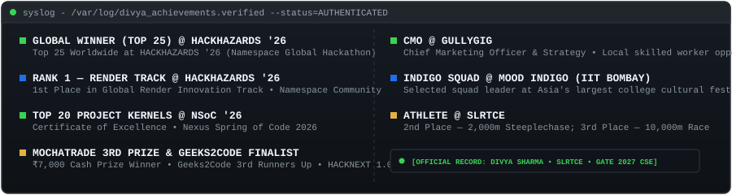
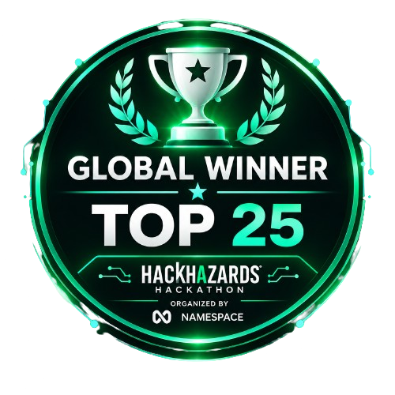
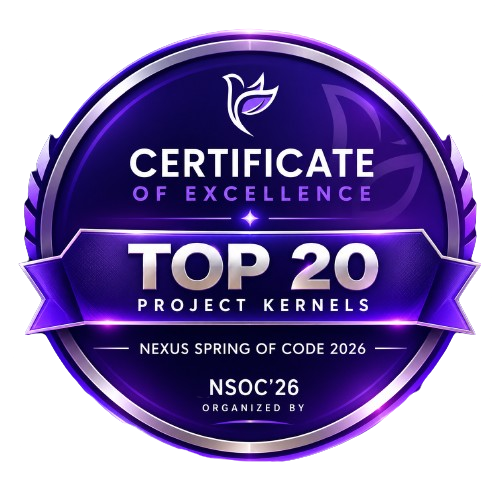
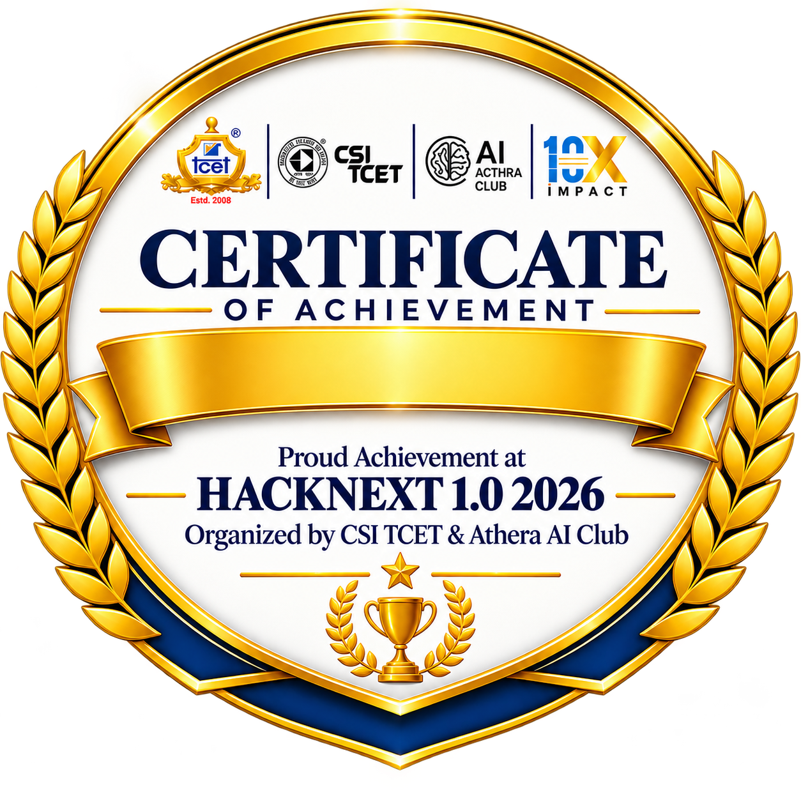
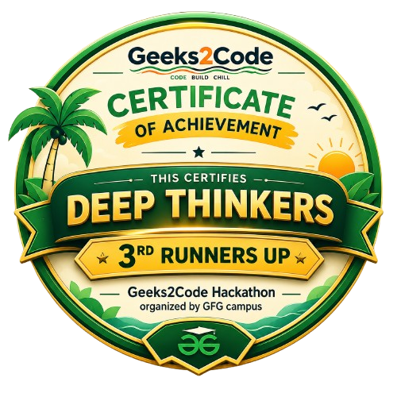

  

   ABOUT" />

| **Divya Sharma**    Computer Engineering undergraduate at **SLRTCE** passionate about AI, ML, DSA, and scalable software. Combining entrepreneurial thinking, hackathon innovation and edge technology to build real-world solutions. Preparing for **GATE 2027 CSE** with the ambition of M.Tech at an IIT.      |     `@divyaa404` |
| :--- | :---: |

 

   TELEMETRY // STATS" />

  

  
  &nbsp;&nbsp;
  

  

 

   PROJECTS" />

|   **[AgriVyaan](https://github.com/divyaa404/AgriVyaan)** Edge-AI autonomous drone system for real-time crop disease detection and offline-first agricultural intelligence.        [**→ View Repository**](https://github.com/divyaa404/AgriVyaan) |   **[Campus360](https://github.com/divyaa404/Campus360)** Comprehensive college management portal automating institutional workflows, academic analytics and scheduling.       [**→ View Repository**](https://github.com/divyaa404/Campus360) |
| :---: | :---: |
|   **[SYNDEO](https://github.com/divyaa404/SYNDEO)** Decentralized personal identity & data graph with privacy-preserving attribute attestations and unified developer footprints.       [**→ View Repository**](https://github.com/divyaa404/SYNDEO) |   **[Swasthya AI](https://github.com/divyaa404/Swasthya-AI)** AI-powered health intelligence platform for symptom analysis, medical guidance and accessible healthcare insights.       [**→ View Repository**](https://github.com/divyaa404/Swasthya-AI) |
| :---: | :---: |

 

   TECH_STACK" />

  
  
  
  
  
  
  
  
  
  
  
  
  
  
  
  
  
  
  
  
  
  
  
  
  

 

   ACHIEVEMENTS" />

  

|  **GLOBAL WINNER — TOP 25** HACKHAZARDS '26 · Namespace |  **RANK 1 — RENDER TRACK** HACKHAZARDS '26 Innovation |  **TOP 20 PROJECT KERNELS** Nexus Spring of Code 2026 |
| :---: | :---: | :---: |
|  **HACKNEXT 1.0 2026** CSI TCET & Athera AI Club |  **3RD PRIZE (₹7,000)** MochaTrade Confederation |  **3RD RUNNERS UP** Geeks2Code (GFG Campus) |

 

   TRANSMISSION // CONNECT" />

  &nbsp;
  &nbsp;
  &nbsp;
  &nbsp;
  &nbsp;
  &nbsp;
  

  

