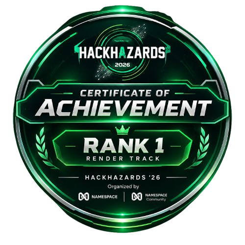

  

   ABOUT" />

| **Divya Sharma**    Computer Engineering undergraduate at **SLRTCE** passionate about AI, ML, DSA, and scalable software. Combining entrepreneurial thinking, hackathon innovation and edge technology to build real-world solutions. Preparing for **GATE 2027 CSE**.      |     `@divyaa404` |
| :--- | :---: |

 

   TELEMETRY // STATS" />

  
  
  

 

   PROJECTS" />

<table width="100%">
  <tr>
    <!-- 1. AgriVyaan -->
    <td width="50%" align="center" valign="top">
      
      

        <b><a href="https://github.com/divyaa404/AgriVyaan">AgriVyaan / AgriSwarm</a></b> 
        Autonomous agricultural drone-based crop monitoring and targeted disease detection system with offline-first agricultural intelligence. 
        <code>Flutter</code> &nbsp;<code>Python</code> &nbsp;<code>YOLO11n</code> &nbsp;<code>ArduPilot</code> &nbsp;<code>MAVLink</code> &nbsp;<code>Supabase</code>
      

    </td>
    <!-- 2. Swasthya AI -->
    <td width="50%" align="center" valign="top">
      
      

        <b><a href="https://github.com/divyaa404/Swasthya-AI">Swasthya AI</a></b> 
        Voice-first multilingual health platform powered by a Neo4j memory graph, connecting symptoms, family history, and recovery over time. 
        <code>TypeScript</code> &nbsp;<code>Neo4j</code> &nbsp;<code>Sarvam AI</code> &nbsp;<code>FastAPI</code> &nbsp;<code>Render Workflows</code>
      

    </td>
  </tr>
  <tr>
    <!-- 3. HackNext -->
    <td width="50%" align="center" valign="top">
      
      

        <b><a href="https://github.com/divyaa404/HackNext">HackNext</a></b> 
        Offline-first, self-hostable hackathon platform for teams, submissions, jury evaluation, Z-score normalization, voting, and verifiable certificates. 
        <code>TypeScript</code> &nbsp;<code>Next.js</code> &nbsp;<code>Tailwind CSS</code> &nbsp;<code>PostgreSQL</code>
      

    </td>
    <!-- 4. SYNDEO -->
    <td width="50%" align="center" valign="top">
      
      

        <b><a href="https://github.com/divyaa404/SYNDEO">SYNDEO</a></b> 
        User-controlled personal data layer turning scattered documents into evidence-linked memory for answering questions, autofilling forms &amp; selective sharing. 
        <code>TypeScript</code> &nbsp;<code>Next.js</code> &nbsp;<code>FastAPI</code> &nbsp;<code>Vector Memory</code>
      

    </td>
  </tr>
</table>
|

 

   TECH_STACK" />

<table width="100%">
  <tr>
    <td width="28%" valign="top">
      <code>&gt; PROGRAMMING_LANGUAGES</code>
    </td>
    <td width="72%" valign="middle">
      
      
      
      
      
    </td>
  </tr>
  <tr>
    <td width="28%" valign="top">
      <code>&gt; FRONTEND_DEV</code>
    </td>
    <td width="72%" valign="middle">
      
      
      
      
      
    </td>
  </tr>
  <tr>
    <td width="28%" valign="top">
      <code>&gt; BACKEND_&amp;_APP</code>
    </td>
    <td width="72%" valign="middle">
      
      
      
      
      
    </td>
  </tr>
  <tr>
    <td width="28%" valign="top">
      <code>&gt; DATABASES_&amp;_SERVICES</code>
    </td>
    <td width="72%" valign="middle">
      
      
      
      
      
      
    </td>
  </tr>
  <tr>
    <td width="28%" valign="top">
      <code>&gt; CLOUD_&amp;_DEVOPS</code>
    </td>
    <td width="72%" valign="middle">
      
      
      
      
      
      
    </td>
  </tr>
  <tr>
    <td width="28%" valign="top">
      <code>&gt; DATA_SCIENCE_&amp;_AI</code>
    </td>
    <td width="72%" valign="middle">
      
      
      
      
      
    </td>
  </tr>
  <tr>
    <td width="28%" valign="top">
      <code>&gt; HARDWARE_&amp;_IOT</code>
    </td>
    <td width="72%" valign="middle">
      
      
      
    </td>
  </tr>
  <tr>
    <td width="28%" valign="top">
      <code>&gt; WORKFLOW_&amp;_DESIGN</code>
    </td>
    <td width="72%" valign="middle">
      
      
      
      
      
      
    </td>
  </tr>
</table>

 

   ACHIEVEMENTS" />

  

<!-- ================================================================= -->
<!--                 HACKATHON ACHIEVEMENTS — SINGLE ROW                -->
<!-- ================================================================= -->

  <table width="100%">
    <tr>
      <td align="center" width="16.66%">
          
        <b>GLOBAL WINNER — TOP 25</b> 
        HACKHAZARDS '26 · Namespace
      </td>
      <td align="center" width="16.66%">
          
        <b>RANK 1 — RENDER TRACK</b> 
        HACKHAZARDS '26 · Innovation
      </td>
      <td align="center" width="16.66%">
          
        <b>TOP 20 PROJECT KERNELS</b> 
        Nexus Spring of Code 2026
      </td>
      <td align="center" width="16.66%">
          
        <b>HACKNEXT 1.0 2026</b> 
        CSI TCET & Athera AI Club
      </td>
      <td align="center" width="16.66%">
          
        <b>3RD PRIZE — ₹7,000</b> 
        MochaTrade Confederation
      </td>
      <td align="center" width="16.66%">
          
        <b>3RD RUNNERS-UP</b> 
        Geeks2Code · GFG Campus
      </td>
    </tr>
  </table>

 

   TRANSMISSION // CONNECT" />

  &nbsp;
  &nbsp;
  &nbsp;
  &nbsp;
  &nbsp;
  &nbsp;
  

  

