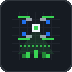

  

 ABOUT" />

<table width="100%" border="0" cellpadding="0" cellspacing="0">
<tr>
<td width="72%" valign="top">
<h2>Divya Sharma</h2>

Computer Engineering undergraduate at <b>Shree L. R. Tiwari College of Engineering (SLRTCE)</b> passionate about Artificial Intelligence, Machine Learning, DSA, and scalable software systems. Combining entrepreneurial thinking, competitive hackathon innovation, and edge technology to build high-impact real-world solutions. Currently preparing for <b>GATE 2027 (Computer Science)</b> with the ambition of pursuing M.Tech at an IIT.

</td>
<td width="28%" align="center" valign="middle">
  
 
<code>@divyaa404</code>
</td>
</tr>
</table>

 

 TELEMETRY // STATS" />

  

  

<table width="100%" border="0" cellpadding="8" cellspacing="0">
<tr>
<td width="25%" align="center">
 

</td>
<td width="25%" align="center">
 

</td>
<td width="25%" align="center">
 

</td>
<td width="25%" align="center">
 

</td>
</tr>
</table>

 

<table width="100%" border="0" cellpadding="0" cellspacing="8">
<tr>
<td width="50%" align="center" valign="top">

</td>
<td width="50%" align="center" valign="top">

</td>
</tr>
</table>

 

  

 PROJECTS" />

  

<table width="100%" border="0" cellpadding="8" cellspacing="0">
<tr>
<td width="50%" valign="top">

<b><a href="https://github.com/divyaa404/AgriVyaan">AgriVyaan</a></b>
 

Edge-AI autonomous agricultural drone monitoring system. Real-time crop disease detection and offline-first telemetry for smart farming.

<a href="https://github.com/divyaa404/AgriVyaan"><b>&gt; Launch Repository →</b></a>
</td>
<td width="50%" valign="top">

<b><a href="https://github.com/divyaa404/GullyGig">GullyGig</a></b>
 

Digital identity and opportunity platform for local skilled workers. Portfolio showcase and hyper-local talent discovery network.

<a href="https://github.com/divyaa404/GullyGig"><b>&gt; Launch Repository →</b></a>
</td>
</tr>
<tr>
<td width="50%" valign="top">

<b><a href="https://github.com/divyaa404/Campus360">Campus360</a></b>
 

Comprehensive college management portal automating institutional operations, student workflows, academic analytics, and faculty scheduling.

<a href="https://github.com/divyaa404/Campus360"><b>&gt; Launch Repository →</b></a>
</td>
<td width="50%" valign="top">

<b><a href="https://github.com/divyaa404/SYNDEO">SYNDEO</a></b>
 

Decentralized personal identity and data graph system enabling privacy-preserving attribute attestations and unified developer footprints.

<a href="https://github.com/divyaa404/SYNDEO"><b>&gt; Launch Repository →</b></a>
</td>
</tr>
<tr>
<td width="50%" valign="top">

<b><a href="https://github.com/divyaa404/BrandShield">BrandShield AI</a></b>
 

Multi-agent brand consistency and content governance platform featuring versioned memory models, compliance auditing, and approval pipelines.

<a href="https://github.com/divyaa404/BrandShield"><b>&gt; Launch Repository →</b></a>
</td>
<td width="50%" valign="top">

<b><a href="https://github.com/divyaa404/Mochatrade">Mochatrade</a></b>
 

High-throughput fintech and quantitative trading platform providing real-time market sentiment intelligence, technical indicators, and execution tools.

<a href="https://github.com/divyaa404/Mochatrade"><b>&gt; Launch Repository →</b></a>
</td>
</tr>
</table>

 

 TECH_STACK" />

 

<table width="100%" border="0" cellpadding="8" cellspacing="0">
<tr>
<td width="25%" valign="top">
<b>[LANGUAGES &amp; DSA]</b>  
 
 
 
 

</td>
<td width="25%" valign="top">
<b>[AI / ML &amp; EDGE]</b>  
 
 
 
 

</td>
<td width="25%" valign="top">
<b>[FRAMEWORKS &amp; WEB]</b>  
 
 
 
 

</td>
<td width="25%" valign="top">
<b>[DATA &amp; DEVOPS]</b>  
 
 
 
 

</td>
</tr>
</table>

 

 ACHIEVEMENTS" />

  

  

<table width="100%" border="0" cellpadding="8" cellspacing="0">
<tr>
<td width="33.3%" align="center" valign="top">
 
<b>GLOBAL WINNER - TOP 25</b> 
HACKHAZARDS &apos;26 • Namespace
</td>
<td width="33.3%" align="center" valign="top">
 
<b>RANK 1 - RENDER TRACK</b> 
HACKHAZARDS &apos;26 Innovation Track
</td>
<td width="33.3%" align="center" valign="top">
 
<b>TOP 20 PROJECT KERNELS</b> 
Nexus Spring of Code 2026
</td>
</tr>
<tr>
<td width="33.3%" align="center" valign="top">
 
 
<b>HACKNEXT 1.0 2026</b> 
CSI TCET &amp; Athera AI Club
</td>
<td width="33.3%" align="center" valign="top">
 
 
<b>3RD PRIZE WINNER (₹7,000)</b> 
MochaTrade Confederation
</td>
<td width="33.3%" align="center" valign="top">
 
 
<b>3RD RUNNERS UP</b> 
Geeks2Code (GFG Campus)
</td>
</tr>
</table>

 

 ACTIVITY_HEATMAP" />

  

  

 TRANSMISSION // CONNECT" />

  

&nbsp;
&nbsp;
&nbsp;
&nbsp;
&nbsp;
&nbsp;

 

